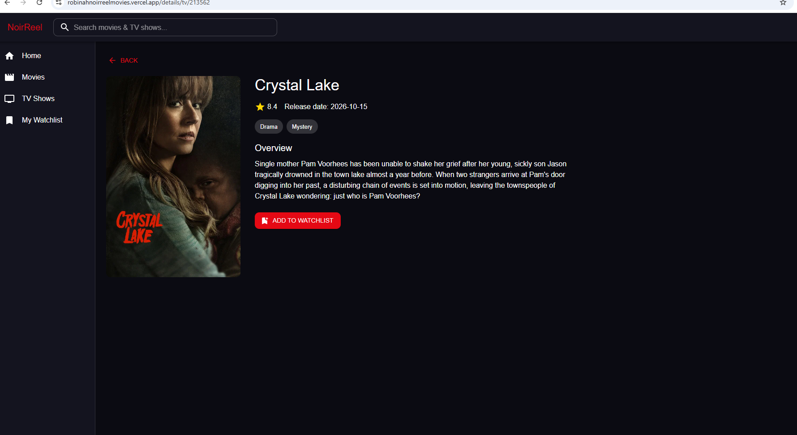

# NoirReel - Movie Discovery Web App

A responsive movie and TV show discovery website built for the Web and Mobile Application Development course.

**Live app:** https://robinahnoirreelmovies.vercel.app/

## Screenshots

### Homepage

### Details page

## Features
- Homepage with Trending, Popular Movies, Action Movies and Popular TV Shows
- Search for movies and TV shows by title
- Movies and TV Shows pages with genre filter and "Load more"
- Details page (poster, overview, release date, rating, genres)
- My Watchlist saved in localStorage
- Responsive layout with a mobile navigation drawer
- Loading, empty-result, missing-poster and error handling

## Technologies
React (JavaScript), Vite, Material UI, React Router, Axios

## API
Data comes from the [TMDB API](https://www.themoviedb.org/).
This product uses the TMDB API but is not endorsed or certified by TMDB.

## Run locally
1. Clone the repository and open the folder
2. Run `npm install`
3. Copy `.env.example` to a new file named `.env` and add your own TMDB API key:
   `VITE_TMDB_API_KEY=your_key_here`
4. Run `npm run dev`
5. Open the local address shown in the terminal

## Notes
The API key is loaded from an environment variable and is not committed to GitHub.

## Author
Robinah Patience